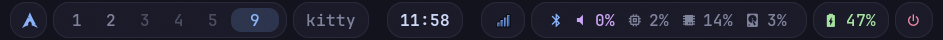

# Mocha

Catppuccin Mocha Hyprland for a laptop: a 40 px floating Waybar with rounded
translucent pills, spring animations, and matching Rofi menus and SwayOSD.



## Features

- **Bar:** launcher, five persistent workspaces, and focused window on the
  left; clock and media in the center; tray, Bluetooth, volume, CPU, memory,
  disk, battery, and power on the right.
- **Menus:** Rofi app launcher, Bluetooth pairing, audio output selection,
  and power menu. Hover the speaker for a volume slider; click the clock
  for the alternate date format, or hover for a calendar.
- **Desktop:** Dwindle tiling, blurred bar pills, three-finger workspace
  gestures, a scratchpad, wallpaper picker, and volume and brightness OSD.
  Chromium opens on workspace 2; Spotify opens on workspace 3.

## Keys

| Key | Action |
| --- | --- |
| `Super+Return` | Kitty |
| `Super+R` | App launcher |
| `Super+B` | Chromium |
| `Super+E` | Nautilus |
| `Super+W` | Wallpaper picker |
| `Super+Q` / `Super+C` | Close window |
| `Super+V` | Toggle floating |
| `Super+H/J/K/L` | Focus window |
| `Super+1–0` | Switch workspace |
| `Super+Shift+1–0` | Move window to workspace |
| `Super+S` / `Super+Shift+S` | Toggle scratchpad / move window to it |
| `F2/F3` | Lower / raise brightness |
| `F7/F8` | Lower / raise volume |

The rest are in [`hypr/hyprland.lua`](hypr/hyprland.lua). Caps Lock also acts
as Super.

## Install

```sh
curl -fsSL https://raw.githubusercontent.com/chaseungjoon/config/main/install.sh | bash -s -- hyprland-mocha "$HOME"
```

**Requires:** Hyprland with Lua configuration support (captured on 0.56.2),
Waybar with the audio slider module, Kitty, Rofi with Wayland support,
Hyprpaper, Waypaper, SwayOSD, JetBrainsMono Nerd Font, Chromium, Nautilus,
playerctl, WirePlumber, pactl, BlueZ, Blueman, and GLib's gdbus.
The optional Wi-Fi menu script uses NetworkManager and nm-connection-editor;
Wi-Fi tray icons require nm-applet, and Bluetooth pairing prompts require
blueman-applet. Start those applets separately if wanted.

No wallpaper is included; set one with `Super+W`. Waypaper saves the choice
in `hyprpaper.conf` for the next login. The screenshots use a temporary dark
background; the bar preview removes the empty space between its three groups.
Display, input, app, and workspace choices can be adjusted in the Lua config.
