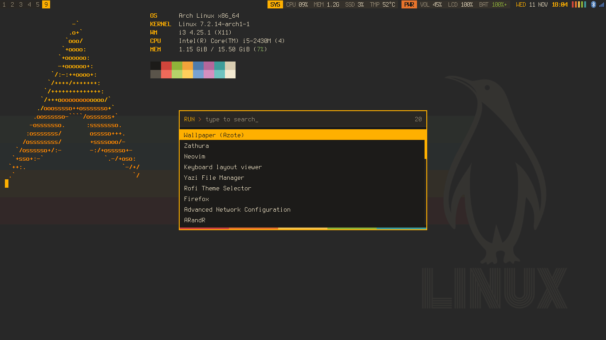
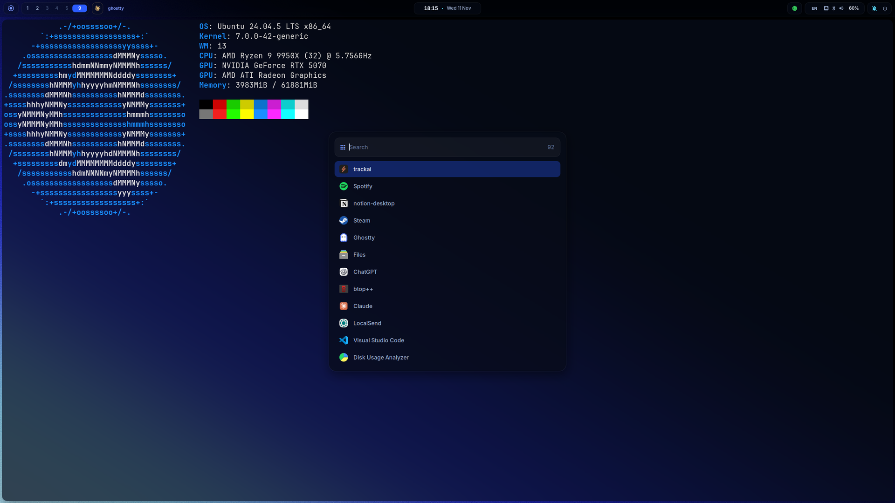

# i3

Two independent i3 setups. Pick one.

| | [Amber](amber/) | [Horizon](horizon/) |
| --- | --- | --- |
| **Focus** | Low motion, light on resources | Polish and AI agent workflows |
| **Bar** | i3blocks, 20 px | Eww, 46 px, with popups |
| **Compositor** | None | Picom (blur, animations) |
| **Terminal** | Kitty | Ghostty |
| **Font** | Terminess Nerd Font | Inter, JetBrainsMono Nerd Font |
| **Palette** | Amber `#ffb000` on charcoal `#1c1b19` | Blue `#2b5cff` on navy `#060a14` |
| **Includes** | The [Arch theme](../arch/) | Its own Rofi, Dunst, and Xresources |

**[Amber](amber/)**: desktop with Kitty and Rofi

**[Horizon](horizon/)**: desktop with Ghostty and Rofi

