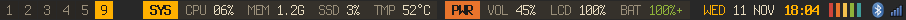

# Amber

Low-motion i3 for constrained hardware: amber on charcoal, square edges,
Terminess Nerd Font, and a 20 px i3blocks bar.



## Features

- **Bar:** CPU, memory, disk, temperature, volume, brightness, battery, date,
  and time, with click and scroll actions.
- **Desktop:** Rofi, autotiling, wallpaper picker, screenshots, OSD, night
  light, monitor switching, and lock and power menus.
- **Keys:** a searchable keysheet. All bindings are in [`i3/config`](i3/config).

## Install

```sh
curl -fsSL https://raw.githubusercontent.com/chaseungjoon/config/main/install.sh | bash -s -- i3-amber "$HOME"
```

This also installs the [Arch desktop theme](../../arch/).

**Requires:** i3, i3blocks, Kitty, Rofi, Dunst, Feh, Azote, and a Nerd Font.
Display, battery, and touchpad names are machine-specific; adjust them in the
config and scripts.
