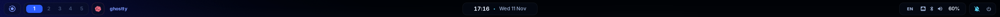

# Horizon

Blue-glass i3 for AI-native workflows: a 46 px Eww bar with rounded pills,
Picom blur and animations, and one palette shared by Rofi, Dunst, the lock
screen, and Xresources.



## Features

- **Bar:** launcher, per-monitor workspaces, focused app, and agent icons on
  the left; clock and media in the center; tray, input language, network,
  Bluetooth, volume, notifications, and power on the right. Hides for
  fullscreen windows.
- **Popups:** click the clock for a calendar and world clock, or the media
  widget for album art and playback controls.
- **Agent tracking:** Claude Code, Codex, and Copilot CLI sessions show as
  icons: yellow (working), red (needs input), green (done), grey (ready).
  Hover for task, model, elapsed time, and token use; click to focus the
  terminal. The optional [`agent-hook`](i3/eww/scripts/agent-hook) improves
  Codex detection.

## Keys

| Key | Action |
| --- | --- |
| `Super+R` | App launcher |
| `Super+F1` | Search keybindings |
| `Super+Shift+H` | Keysheet |
| `Super+D` | Switch input language |
| `Super+Shift+W` | Wallpaper picker |
| `Super+Shift+D` | Do not disturb |
| `Super+H/J/K/L` | Focus window |
| `Super+Ctrl+H/J/K/L` | Resize window |

The rest are in [`i3/config`](i3/config).

## Install

```sh
curl -fsSL https://raw.githubusercontent.com/chaseungjoon/config/main/install.sh | bash -s -- i3-horizon "$HOME"
```

**Requires:** i3, Ghostty, Eww, Picom v13, Rofi, Dunst, Feh, xss-lock, xdotool,
playerctl, WirePlumber, and Fcitx5. Some `bin/` shims expect local builds in
`~/.local/opt/i3-extras`. No wallpaper is included; set one with
`Super+Shift+W`.
